<div align="center">

<a href="https://yasir-portfolio-omega.vercel.app">
  
</a>

<br/>

<a href="https://yasir-portfolio-omega.vercel.app"></a>
<a href="https://linkedin.com/in/yasir-mehmood-53549a1b3"></a>
<a href="mailto:yash36114@gmail.com"></a>
<a href="https://yasir-portfolio-omega.vercel.app/Yasir-Mehmood-Resume.pdf"></a>

**[About](#-about-me) · [Tech stack](#️-tech-stack) · [Impact](#-impact-in-production) · [Projects](#-featured-open-source-projects) · [Journey](#️-career-journey) · [Stats](#-github-stats) · [Contact](#-lets-connect)**

</div>


## 👋 About me

I'm **Yasir Mehmood**, a **Senior Consultant at Deloitte** (Business Process Solutions) and a **senior full-stack .NET, Angular and AI engineer** with 5+ years shipping production systems in **fintech, healthcare, tax technology and generative AI**.

I design back ends on **modern .NET (.NET 10 / 8, ASP.NET Core, Clean Architecture, CQRS, microservices)**, build front ends in **Angular 20** with Signals and NgRx, and bring in **Python / FastAPI** and **LLM, RAG and AI-agent** solutions with OpenAI, Claude and Azure OpenAI — always with security (PCI-DSS, HIPAA, SSO / RBAC) designed in from day one.

```ts
const yasir = {
  role:      "Senior Consultant @ Deloitte · Full-Stack (.NET & Angular) & AI Engineer",
  basedIn:   "Islamabad, Pakistan 🇵🇰  — working remotely with teams in KSA, Canada & the US",
  backend:   [".NET 10", "ASP.NET Core", "CQRS", "RabbitMQ / MassTransit", "gRPC", "SignalR"],
  frontend:  ["Angular 20 (Signals, standalone)", "NgRx", "React", "Next.js", "TypeScript"],
  ai:        ["RAG", "LangChain", "FAISS", "AI agents", "MCP", "OpenAI", "Claude", "Azure OpenAI"],
  domains:   ["Payments", "AML / KYC", "Healthcare (HIPAA)", "Tax tech (CIT & Zakat)"],
  motto:     "Build for scale from day one — event-driven, observable, secure by design.",
};
```

<table>
<tr>
<td width="50%" valign="top">

### 🔭 Currently building
- 🧾 **Saudi CIT & Zakat automation** — calculation workflows, validations, returns and reporting *(Deloitte, client confidential)*
- 🔗 **Odoo 19 Enterprise ↔ .NET integration** — SSO, RBAC, APIs and secure data exchange
- 🤖 **Agentic AI & RAG workflows** in Python for enterprise automation

</td>
<td width="50%" valign="top">

### 💜 Things I love building
- ⚡ High-throughput, event-driven back ends that never lose a message
- 📊 Real-time dashboards people actually enjoy using
- 🧠 LLM features grounded in real data — with guardrails
- 🛡️ Security-first platforms in regulated industries

</td>
</tr>
</table>


## 🛠️ Tech stack

<p align="center">
  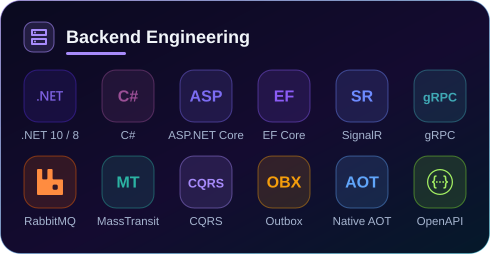
  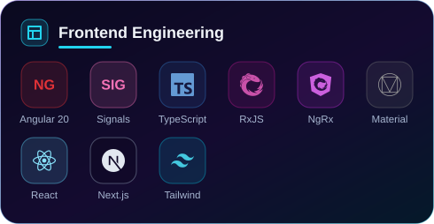
</p>
<p align="center">
  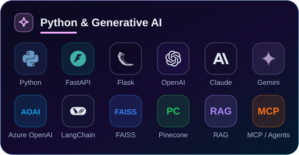
  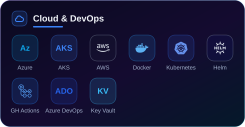
</p>
<p align="center">
  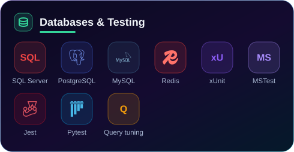
  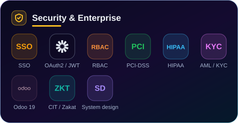
</p>


## 📈 Impact in production

<p align="center">
  
</p>

<details>
<summary><b>🔒 Professional highlights</b> — the systems behind those numbers (client code is confidential)</summary>
<br/>

| System | What I did | Stack |
|---|---|---|
| 🏦 **1LINK Payment Switch** | Engineered an interbank switch processing **1M+ transactions/day at 99.9% uptime**; Outbox Pattern for guaranteed delivery; passed external PCI-DSS audits | .NET 6 · RabbitMQ · MassTransit · AKS |
| 📊 **Jazz Retailer Portal** | Architected real-time analytics for **10,000+ retailers** — **60% faster dashboards**, 40% less manual reporting | Angular 18 · .NET 8 |
| 🛡️ **AML Fraud Detection** | NADRA identity APIs + ML anomaly scoring across **5+ banks**, **~30% fewer false positives** | Angular 17 · .NET 8 · Python |
| 🏥 **HIPAA Web EHR** | Real-time clinical notification engine with **sub-200ms** alerts; **45% faster** SQL on 10M+ rows; RBAC + audit logging | Angular 13 · .NET Core · SignalR · Redis |
| 🤖 **Enterprise RAG chatbot** | Production RAG over **100K+ chunks** — **35% fewer tickets, +30% CSAT**; AI agents with tools, memory and MCP | Python · LangChain · FAISS · GPT-4 |
| 🧾 **CIT & Zakat automation** | Saudi tax-technology solution; Odoo 19 ↔ .NET integration architecture with SSO, RBAC and secure data exchange | .NET · Python · FastAPI · Odoo 19 |

<sub>Metrics come from my work at AKSA-SDS, MTBC CareCloud, Markitech.AI and Deloitte. Those codebases belong to employers and clients and aren't public.</sub>

</details>


## 🚀 Featured open-source projects

<p align="center">
  <a href="https://github.com/yasirmalik36/payment-switch-api">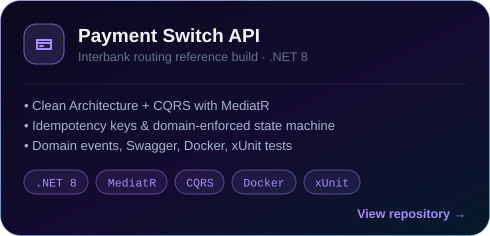</a>
  <a href="https://github.com/yasirmalik36/rag-chatbot">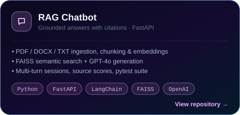</a>
</p>
<p align="center">
  <a href="https://github.com/yasirmalik36/smart-employee-portal-backend">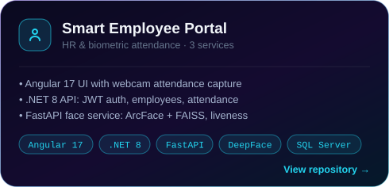</a>
  <a href="https://github.com/yasirmalik36/employee-management-system">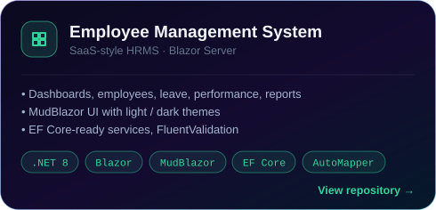</a>
</p>

<p align="center"><sub>Smart Employee Portal is three repos: <a href="https://github.com/yasirmalik36/smart-employee-portal-frontend">frontend</a> · <a href="https://github.com/yasirmalik36/smart-employee-portal-backend">backend</a> · <a href="https://github.com/yasirmalik36/smart-employee-portal-face-recognition">face recognition</a></sub></p>


## 🗺️ Career journey

<p align="center">
  
</p>

🎓 **BS Software Engineering**, Virtual University of Pakistan (2021 – 2025) · 📜 **AI with Python**, Great Learning · 📱 **Android App Development**, PSDF · 🗣️ English (professional), Urdu (native)


## 📊 GitHub stats

<p align="center">
  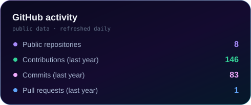
  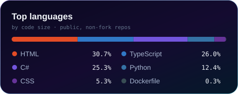
</p>
<p align="center">
  
</p>
<p align="center"><sub>Generated daily from public data by a GitHub Action in this repo — no third-party stats service.</sub></p>

## ✍️ Writing

- 📖 [Building Production RAG Systems with .NET & LangChain](https://yasir-portfolio-omega.vercel.app/blog/production-rag-systems)
- 📖 [AI Agents in Enterprise Applications](https://yasir-portfolio-omega.vercel.app/blog/ai-agents-enterprise)
- 📖 [Outbox Pattern in Distributed Systems](https://yasir-portfolio-omega.vercel.app/blog/outbox-pattern)
- 📖 [RabbitMQ Retry Mechanisms & Dead Letter Queues](https://yasir-portfolio-omega.vercel.app/blog/rabbitmq-retry)
- 📖 [Real-time Apps with SignalR & Redis Backplane](https://yasir-portfolio-omega.vercel.app/blog/signalr-redis)

<details>
<summary><b>🐞 Developer jokes & fun facts</b> (click me, Byte insists)</summary>
<br/>

> **Why did the message queue break up with the database?** It needed space to process its feelings — *asynchronously*.

> **My favourite design pattern?** The Outbox Pattern. Because a message I promised to send *is* a message that gets sent. 📨

> **RAG, explained to my non-tech friends:** an AI that checks its notes before answering. Basically, the student we all wished we were.

- 🤖 **Byte**, the little robot up top, is drawn entirely in SVG — no image files, just shapes and CSS animation.
- 🌍 My code has shipped for teams in **Pakistan, Saudi Arabia, Canada and the US**.
- ⚡ The busiest system I've worked on handled **over a million transactions a day** — and the best day is the one nobody notices it.

</details>

## 🤝 Let's connect

<div align="center">

<a href="https://linkedin.com/in/yasir-mehmood-53549a1b3">
  
</a>

<br/>

<a href="https://yasir-portfolio-omega.vercel.app"></a>
<a href="https://linkedin.com/in/yasir-mehmood-53549a1b3"></a>
<a href="mailto:yash36114@gmail.com"></a>


</div>
